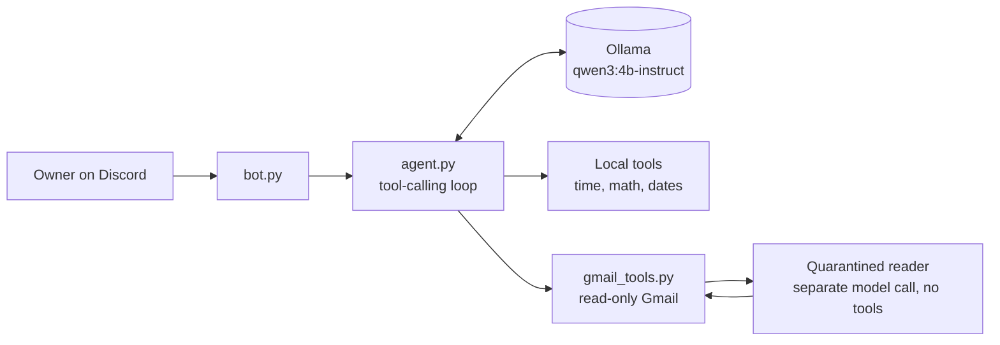

# on-device-agent

A private AI agent that runs entirely on-device: a 4-core CPU, 8 GB RAM, no
GPU, no cloud. Every query stays local and costs nothing.

It uses a 4B-parameter model (`qwen3:4b-instruct`) through
[Ollama](https://ollama.com), calls tools (date math, arithmetic, read-only
Gmail), and is used through a private Discord bot. It runs around the clock on
an HP ProDesk 600 G3 (i5-6600) at about 8.5 tokens/sec.

## The question

How capable and how safe can a personal agent be when the model is small and
the hardware is minimal? This project explores two sides of that:

- **Capability:** a 4B model takes shortcuts and doesn't check its own work.
  How much can tool design, prompting and loop limits make up for that?
- **Safety:** an agent that reads email, web pages or documents is exposed to
  prompt injection. Which defenses hold up when the model itself is too small
  to reliably resist it?

Each new feature is a step in exploring both. Email came first.

## What it does

- Answers questions in Discord, keeping short per-channel conversation history
- Lists recent emails and summarizes individual ones ("what's my latest email?")
- Uses tools for anything a small model gets wrong on its own: the current
  date/time, days until a date, addition and multiplication

## Architecture



- **`agent.py`**: the agent loop. It sends the conversation and tool list to
  the model, runs any tool calls it asks for, feeds the results back, and repeats
  until the model gives a final answer or hits a 6-step limit. Tool errors go
  back to the model as text so it can recover instead of crashing.
- **`gmail_tools.py`**: `check_inbox`, `read_email` and `read_latest_email`.
  Tool schemas are generated from the Python type hints and docstrings.
- **`bot.py`**: Discord front end. Only responds to one owner account, runs
  the blocking agent in a worker thread, and splits long replies to fit
  Discord's message limit. `!reset` clears the conversation.
- **`gmail_auth.py`**: one-time OAuth sign-in that saves a token with `0600`
  permissions.
- **`learning/`**: the first two steps of the project: a single model call,
  then a single round of tool calls.

## Security design

An assistant that reads email is an easy target for prompt injection: anyone
can send it text like "ignore your instructions and...". The design assumes
email content is hostile:

1. **Quarantined reading.** Raw email bodies never reach the agent that can call
   tools. `read_email` passes the body (truncated to 3000 chars) to a separate
   model call that has no tools and runs at temperature 0. It returns a 2-3
   sentence summary and calls out any instructions aimed at an AI. The main
   agent only ever sees that summary.
2. **Sanitized headers.** Sender, subject and date go to the agent directly, so
   they're cleaned first: the sender is reduced to the bare address (display
   names are free text), control and invisible Unicode characters are stripped,
   and subjects are capped at 80 characters.
3. **Least privilege.** Gmail access uses the `gmail.readonly` scope, so even a
   successful injection can't send, delete or modify mail.
4. **Single owner.** The Discord bot ignores everyone except the configured
   owner ID.
5. **Rule for future write actions.** Any tool with side effects (sending
   email, editing documents) must require the owner's approval via a ✅
   reaction in Discord, enforced in code rather than in the prompt.

## Designing for a 4B model

Small models take shortcuts and don't check their own work, so the tools are
built to compensate:

- Tools do a whole job in one call (`read_latest_email` instead of
  "list, then pick an id, then read") and validate their inputs
  (`days_until` rejects past dates with a message saying how to fix it).
- The system prompt is regenerated each turn with today's date, and tells the
  model to re-query the inbox instead of trusting earlier results.
- Prompts and tool outputs are kept short, because prompt processing runs at
  roughly 27 tokens/sec on this CPU.

## Setup

```bash
python3 -m venv .venv
source .venv/bin/activate
pip install -r requirements.txt
ollama pull qwen3:4b-instruct
cp .env.example .env        # fill in DISCORD_TOKEN and OWNER_ID
```

For Gmail, create an OAuth client (Desktop app) in Google Cloud Console with the
Gmail API enabled, save it as `credentials.json`, then run:

```bash
python gmail_auth.py        # open the printed URL to sign in; writes token.json
```

## Running

```bash
python agent.py             # chat in the terminal
python bot.py               # run the Discord bot
python gmail_tools.py       # smoke test: summarize the newest email
```

On the home server the bot runs as a systemd service, `agent-bot`.

## Roadmap

- [x] Agent loop with tool calling on a local 4B model
- [x] Read-only Gmail with quarantined summaries and sanitized headers
- [x] Discord front end, single owner
- [ ] Eval harness: a set of prompt-injection test emails, measuring attack
      success with and without quarantine, plus latency cost on CPU
- [ ] Actions with side effects, gated by a ✅ reaction in Discord and enforced
      in code
- [ ] More tools, each added to the eval harness as it lands
